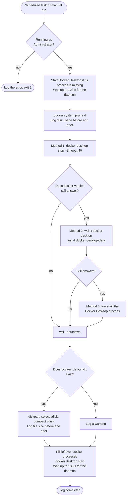

# Docker WSL Disk Cleanup & Compact Script

A PowerShell script for automated Docker maintenance on Windows with WSL2 backend. This script performs monthly Docker cleanup and virtual disk compaction to prevent disk space bloat and maintain optimal Docker performance.

## Overview

Docker Desktop with WSL2 backend can accumulate significant disk space over time due to:
- Unused containers, images, and build cache
- WSL2 virtual disk files that grow but never shrink automatically
- Dangling volumes and networks

This script automates the cleanup process and can reclaim **substantial disk space** (users typically see 20-140GB+ freed during initial runs).

## Features

- ✅ **Automated Docker cleanup** - Removes stopped containers, dangling images, unused networks, and build cache
- ✅ **WSL2 virtual disk compaction** - Shrinks Docker's virtual disk file to actual usage size  
- ✅ **Graceful Docker daemon shutdown** - Prevents "WSL distro terminated abruptly" errors
- ✅ **Comprehensive logging** - Detailed logs for monitoring and troubleshooting
- ✅ **Safe restart sequence** - Ensures Docker Desktop restarts cleanly after maintenance
- ✅ **Multiple fallback methods** - Handles different Docker Desktop versions and configurations
- ✅ **Production ready** - Designed for unattended monthly automation

## Prerequisites

- **Windows 10/11** with WSL2 enabled
- **Docker Desktop** with WSL2 backend
- **PowerShell 5.1** or later  
- **Administrator privileges** (required for diskpart operations)

## Installation

1. **Download the script** to your preferred location (e.g., C:\Scripts\)
2. **Create the log directory**: New-Item -ItemType Directory -Path "C:\Logs" -Force
3. **Test the script** by running it manually first

## Usage

### Manual Execution
# Run as Administrator
.\docker_wsl_compact_vdisk.ps1

### Custom Log Location
.\docker_wsl_compact_vdisk.ps1 -LogPath "D:\MyLogs\DockerCleanup.log"

## Automated Scheduling

### Option 1: Windows Task Scheduler (Recommended)
1. Open **Task Scheduler** as Administrator
2. **Create Basic Task** → Name: "Docker Monthly Cleanup"
3. **Trigger**: Monthly (first Sunday at 3:00 AM recommended)
4. **Action**: Start a program
   - **Program**: powershell.exe
   - **Arguments**: -ExecutionPolicy Bypass -File "C:\Scripts\docker_wsl_compact_vdisk.ps1"
5. **Settings**:
   - ✅ **Check "Run with highest privileges"** (REQUIRED)
   - ✅ **Check "Run whether user is logged on or not"**
   - Configure for: Windows 10/11

### Option 2: PowerShell Scheduled Job
# Run once as Administrator to create the scheduled job

# First command - create the trigger
$trigger = New-JobTrigger -Weekly -WeeksInterval 4 -DaysOfWeek Sunday -At 3AM

# Second command - register the scheduled job (user-agnostic)
Register-ScheduledJob -Name "DockerMonthlyCleanup" -ScriptBlock {
    & "$env:USERPROFILE\dev\docker_wsl_compact_vdisk\docker_wsl_compact_vdisk.ps1"
} -Trigger $trigger

## How it works

Last checked against the code: 2026-10-09, commit 52ede28.

One PowerShell file, `docker_wsl_compact_vdisk.ps1`, about 215 lines. It has no dependencies beyond what Windows and Docker Desktop already ship: the `docker` CLI, `wsl.exe` and `diskpart`.

One sentence for the design: **delete what Docker no longer needs, stop Docker and WSL cleanly so the disk file is not in use, shrink the file, then start Docker again.**

The compaction step is the reason the script exists. Deleting images frees space inside Docker's virtual disk, but the `.vhdx` file on the Windows drive stays the same size until something compacts it.

### The pieces

| Piece | What it does |
|---|---|
| `-LogPath` parameter | Where the log goes. Default `C:\Logs\DockerCleanup.log`. The folder is created if it is missing. |
| `Write-Log` | Puts a timestamp on a message, prints it and appends it to the log file. Every step goes through it. |
| `Wait-ForDocker` | Runs `docker version` every 5 seconds until the daemon answers with a version or the timeout passes (120 seconds by default). |
| `Stop-DockerDaemon` | Stops Docker with three methods in order, checking after each one. |
| Main block | The run itself, inside one `try` / `catch` that logs the error and exits with code 1. |

### One run

The same run as steps:

1. **Check for Administrator.** `diskpart` needs it. Without it the script logs an error and exits with code 1.
2. **Make sure Docker is up.** If no `Docker Desktop` process exists, the script launches `Docker Desktop.exe` from `C:\Program Files\Docker\Docker` and waits 15 seconds. Then it polls for up to 120 seconds.
3. **Record disk usage.** `docker system df` goes into the log.
4. **Prune.** `docker system prune -f` removes stopped containers, networks no container uses, dangling images and unused build cache. Its output goes into the log line by line.
5. **Record disk usage again.**
6. **Stop Docker.** Three methods in order (table below).
7. **Shut down WSL.** `wsl --shutdown`, then a 5 second wait. This stops every WSL distro on the machine.
8. **Compact.** The script writes a three-line diskpart script (`select vdisk`, `compact vdisk`, `exit`) to a temp file, runs `diskpart /s` on it, deletes the temp file, and logs the `.vhdx` size before and after plus the difference.
9. **Start Docker again.** It force-kills `Docker Desktop`, `com.docker.backend` and `com.docker.service` if any are left, runs `docker desktop start`, and polls for up to 180 seconds.
10. **Log the completed line.**

### Stopping Docker: three methods

After methods 1 and 2 the script runs `docker version`. A non-zero exit code means the daemon is down and the later methods are skipped.

| Order | Method | Wait before checking |
|---|---|---|
| 1 | `docker desktop stop --timeout 30` | 5 seconds |
| 2 | `wsl -t docker-desktop` and `wsl -t docker-desktop-data` | 10 seconds |
| 3 | Force-kill the `Docker Desktop` process | 10 seconds, no check |

Whatever happens here, the run carries on to `wsl --shutdown`.

### What it leaves alone

| Left alone | Why it survives |
|---|---|
| Tagged images, even unused ones | The prune runs without `-a`, so only dangling images go. Commit 0a51e66 removed `-a` so that unused MCP server images are not deleted. |
| Volumes | `docker system prune` does not touch volumes unless `--volumes` is passed, and the script does not pass it. |
| Running containers and their images and networks | Prune only removes what is unused. |
| The disks of other WSL distros | Only `docker_data.vhdx` is compacted. |

### What happens when something fails

| Situation | What the script does |
|---|---|
| Not Administrator | Logs `ERROR: Script must be run as Administrator`, exits 1 |
| Docker never becomes ready at the start | Logs a warning and carries on (see Known limits) |
| `docker desktop stop` does not stop the daemon | Tries method 2, then method 3 |
| `docker_data.vhdx` is not at the expected path | Logs a warning, skips compaction, still restarts Docker |
| The `docker` command is not found at restart | Launches `Docker Desktop.exe` directly, or logs an error if that file is missing too |
| A PowerShell error anywhere in the run | Logs the message and stack trace, exits 1 |

### Decisions and what they cost

| Decision | Cost |
|---|---|
| Prune without `-a` | Unused tagged images keep their space until someone removes them by hand |
| Volumes are never pruned | Orphaned volumes pile up over time |
| Stop the Docker daemon first, then shut down WSL | Up to about a minute of extra waits across the three methods |
| `wsl --shutdown` instead of stopping only Docker's distros | Anything running in another WSL distro is stopped, and the script does not start it again |
| Compact with `diskpart` and a generated script file | Needs Administrator, so the scheduled task needs "Run with highest privileges" |
| One fixed disk path under `%LOCALAPPDATA%\Docker\wsl\disk` | A Docker install that keeps its disk elsewhere gets a warning and no compaction |
| Start Docker with `docker desktop start` | Depends on a Docker Desktop version that has the `docker desktop` commands |
| Fixed waits (`Start-Sleep`) between steps | The run takes the same pauses on a fast machine as on a slow one |

### Known limits

- **The start-up check never fails the run.** `Write-Log` returns the text it logs, so `Wait-ForDocker` returns its log lines along with `$true` or `$false`. PowerShell treats that list as true. If Docker is not ready after 120 seconds the run continues anyway.
- **A failed command does not stop the run.** `docker`, `wsl` and `diskpart` report failure through exit codes, and the `try` / `catch` only catches PowerShell errors. A failed prune or compaction shows up in the log output, and the last line still reads `Completed Successfully`.
- **The final wait is not checked.** If Docker is not back after 180 seconds, the log has a warning followed by the completed line.
- **The `Docker Desktop.exe` fallback at restart only runs when the `docker` command cannot be found.** A `docker desktop start` that runs and fails does not trigger it.
- **Paths are fixed.** The Docker Desktop install folder and the disk location are written into the script.
- **No dry run and no tests.** The only way to see what a run would do is to read the log of a real one.

## Expected Results

### Initial Run
- **Docker cleanup**: 5-50GB typically freed
- **Disk compaction**: 20-140GB+ reclaimed from bloated virtual disk
- **Total time**: 2-5 minutes

### Monthly Runs
- **Docker cleanup**: 2-20GB freed (depends on usage)
- **Disk compaction**: 1-10GB reclaimed
- **Total time**: 1-3 minutes

## Log Files

Logs are stored at C:\Logs\DockerCleanup.log by default and include:
- Timestamp for each operation
- Docker disk usage before/after cleanup
- Space reclaimed by each phase
- Any errors or warnings
- Complete diskpart output for troubleshooting

### Sample Log Output
2025-09-16 01:26:39 - === Starting Docker Monthly Cleanup ===
2025-09-16 01:26:44 - Initial usage: Images: 8.069GB, Containers: 64.88MB, Volumes: 25.76GB
2025-09-16 01:26:45 - Gracefully stopping Docker daemon...
2025-09-16 01:27:11 - Docker daemon stopped successfully via CLI
2025-09-16 01:27:17 - Initial VHDX size: 40.22 GB
2025-09-16 01:27:45 - Final VHDX size: 40.22 GB
2025-09-16 01:27:52 - Docker is ready. Version: 27.4.0
2025-09-16 01:27:52 - === Docker Monthly Cleanup Completed Successfully ===

## Troubleshooting

### Docker Won't Start After Scheduled Task Runs
- **Cause**: Scheduled task not running with highest privileges
- **Solution**: Edit scheduled task → Check "Run with highest privileges"
- **Note**: The `docker desktop start` CLI command requires admin rights to work from scheduled tasks

### Docker Desktop Won't Start (Manual Intervention Needed)
- **Symptoms**: Script completes but Docker doesn't start automatically
- **Manual fix**:
  1. Open Task Manager → End all Docker processes
  2. Launch Docker Desktop from Start menu
- **Prevention**: Ensure scheduled task has "Run with highest privileges" checked

### "Access Denied" Errors
- **Cause**: Script not running as Administrator
- **Solution**: Always run PowerShell as Administrator or enable "Run with highest privileges" in Task Scheduler

### Script Can't Find Docker Disk
- **Cause**: Non-standard Docker installation location
- **Solution**: Check script logs for actual disk location and update path

### PowerShell Execution Policy Error
Set-ExecutionPolicy -ExecutionPolicy RemoteSigned -Scope CurrentUser

## Technical Details

### Docker Disk Locations
The script looks for Docker's WSL disk in one place:
- %LOCALAPPDATA%\Docker\wsl\disk\docker_data.vhdx

### Supported Docker Versions
- Docker Desktop 4.0+ with WSL2 backend
- Works with both Windows Home and Pro editions

### Safety Features
- **Administrator check** - Prevents permission issues
- **Docker readiness verification** - Ensures Docker is operational before cleanup
- **Multiple shutdown methods** - Graceful → Forceful fallback
- **Error handling** - Comprehensive try/catch blocks
- **Shutdown verification** - Checks that the daemon is down after each stop method

## License

This script is provided as-is for personal and commercial use. No warranty implied.

---

**Disk space is precious. Keep your Docker installation clean!** 🐳✨
