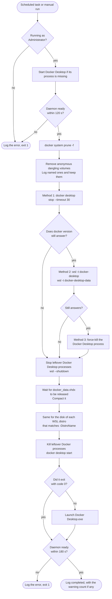

# Docker WSL Disk Cleanup & Compact Script

A PowerShell script for automated Docker maintenance on Windows with WSL2 backend. This script performs monthly Docker cleanup and compacts both Docker's virtual disk and your WSL distro's virtual disk, so the space you free actually comes back to Windows.

## Overview

Docker Desktop with WSL2 backend can accumulate significant disk space over time due to:
- Unused containers, images, and build cache
- WSL2 virtual disk files that grow but never shrink automatically
- Dangling volumes and networks

This script automates the cleanup process and can reclaim **substantial disk space** (users typically see 20-140GB+ freed during initial runs).

## Features

- ✅ **Automated Docker cleanup** - Removes stopped containers, dangling images, unused networks, build cache, and anonymous volumes (named volumes are kept)
- ✅ **WSL2 virtual disk compaction** - Shrinks Docker's virtual disk file and your WSL distro's (Ubuntu by default)  
- ✅ **Graceful Docker daemon shutdown** - Prevents "WSL distro terminated abruptly" errors
- ✅ **Comprehensive logging** - Detailed logs for monitoring and troubleshooting
- ✅ **Safe restart sequence** - Ensures Docker Desktop restarts cleanly after maintenance
- ✅ **Multiple fallback methods** - Handles different Docker Desktop versions and configurations
- ✅ **Production ready** - Designed for unattended monthly automation

## Prerequisites

- **Windows 10/11** with WSL2 enabled
- **Docker Desktop** with WSL2 backend
- **PowerShell 5.1** or later  
- **Administrator privileges** (required for diskpart operations)

## Installation

1. **Download the script** to a folder on a Windows drive (e.g., C:\Scripts\), not inside a WSL distro
2. **Create the log directory**: New-Item -ItemType Directory -Path "C:\Logs" -Force
3. **Test the script** by running it manually first

## Usage

### Manual Execution
# Run as Administrator
.\docker_wsl_compact_vdisk.ps1

### Custom Log Location
.\docker_wsl_compact_vdisk.ps1 -LogPath "D:\MyLogs\DockerCleanup.log"

### Choosing Which WSL Distro Disks to Compact
By default the script compacts the disk of every WSL distro whose name starts with "Ubuntu". Run `wsl -l -v` to see your distro names.

# A different distro
.\docker_wsl_compact_vdisk.ps1 -DistroName "Debian"

# Every registered distro
.\docker_wsl_compact_vdisk.ps1 -DistroName "*"

**Heads up:** the script runs `wsl --shutdown`, which closes everything running in WSL. Save your work first, or schedule it for a time you are not using WSL.

## Automated Scheduling

### Option 1: Windows Task Scheduler (Recommended)
1. Open **Task Scheduler** as Administrator
2. **Create Basic Task** → Name: "Docker Monthly Cleanup"
3. **Trigger**: Monthly (first Sunday at 3:00 AM recommended)
4. **Action**: Start a program
   - **Program**: powershell.exe
   - **Arguments**: -ExecutionPolicy Bypass -File "C:\Scripts\docker_wsl_compact_vdisk.ps1"
5. **Settings**:
   - ✅ **Check "Run with highest privileges"** (REQUIRED)
   - ✅ **Check "Run whether user is logged on or not"**
   - Configure for: Windows 10/11

### Option 2: PowerShell Scheduled Job
# Run once as Administrator to create the scheduled job

# First command - create the trigger
$trigger = New-JobTrigger -Weekly -WeeksInterval 4 -DaysOfWeek Sunday -At 3AM

# Second command - register the scheduled job (user-agnostic)
Register-ScheduledJob -Name "DockerMonthlyCleanup" -ScriptBlock {
    & "C:\Scripts\docker_wsl_compact_vdisk.ps1"
} -Trigger $trigger

## How it works

Last checked against the code: 2026-10-09, commit 5002231.

One PowerShell file, `docker_wsl_compact_vdisk.ps1`, about 330 lines. It has no dependencies beyond what Windows and Docker Desktop already ship: the `docker` CLI, `wsl.exe` and `diskpart`.

One sentence for the design: **delete what Docker no longer needs, stop Docker and WSL cleanly so the disk files are not in use, shrink the files, then start Docker again.**

The compaction step is the reason the script exists. Deleting images or files frees space inside a WSL virtual disk, but the `.vhdx` file on the Windows drive stays the same size until something compacts it. That is true of Docker's disk and of the disk behind your WSL distro, so the script compacts both.

### The pieces

| Piece | What it does |
|---|---|
| `-LogPath` parameter | Where the log goes. Default `C:\Logs\DockerCleanup.log`. The folder is created if it is missing. |
| `-DistroName` parameter | Which WSL distros get their disk compacted. Default `Ubuntu*`. Wildcards work. |
| `Write-Log` | Puts a timestamp on a message, prints it and appends it to the log file. Every step goes through it. |
| `Write-Warn` | Logs a `WARNING:` line and adds one to the warning count. |
| `Wait-ForDocker` | Runs `docker version` every 5 seconds until the daemon answers with a version or the timeout passes (120 seconds by default). Returns true or false. |
| `Stop-DockerDaemon` | Stops Docker with three methods in order, checking after each one. |
| `Stop-DockerProcesses` | Force-stops `Docker Desktop`, `com.docker.backend` and `com.docker.service` if they are running. |
| `Wait-ForFileRelease` | Tries to open a file with no sharing every 5 seconds, for up to 60 seconds. Returns true once nothing else holds the file. |
| `Compact-Vhdx` | Waits for one `.vhdx` file to be released, compacts it with `diskpart` and logs its size before and after. |
| Main block | The run itself, inside one `try` / `catch` that logs the error and exits with code 1. |

### One run

The same run as steps:

1. **Check for Administrator.** `diskpart` needs it. Without it the script logs an error and exits with code 1.
2. **Make sure Docker is up.** If no `Docker Desktop` process exists, the script launches `Docker Desktop.exe` from the Docker folder under Program Files and waits 15 seconds. Then it polls for up to 120 seconds. If Docker is still not ready, the script exits with code 1. Nothing has been stopped or deleted at that point.
3. **Record disk usage.** `docker system df` goes into the log.
4. **Prune.** `docker system prune -f` removes stopped containers, networks no container uses, dangling images and unused build cache. Its output goes into the log line by line.
5. **Remove anonymous volumes.** The script lists dangling volumes. One whose name is 64 hex characters is an anonymous volume and is removed. Any other name is a volume somebody named, so it is logged as skipped and kept.
6. **Record disk usage again.**
7. **Stop Docker.** Three methods in order (table below).
8. **Stop what is left of Docker Desktop.** Its background processes are force-stopped. Docker Desktop can sit in a "stopping" state with the disk file still open, and `diskpart` then fails with "being used by another process".
9. **Shut down WSL.** `wsl --shutdown`, then a 5 second wait. This stops every WSL distro on the machine, which is what frees their disks for compaction.
10. **Compact Docker's disk.** `docker_data.vhdx` under `%LOCALAPPDATA%\Docker\wsl\disk`.
11. **Compact the distro disks.** The script reads the registered WSL distros from the registry (`HKCU:\Software\Microsoft\Windows\CurrentVersion\Lxss`), keeps the ones whose name matches `-DistroName`, and compacts each one's `.vhdx`.
12. **Start Docker again.** It stops any Docker Desktop process that is still around and runs `docker desktop start`. If that command is missing or exits with an error, it launches `Docker Desktop.exe` directly.
13. **Check Docker came back.** It polls for up to 180 seconds. If Docker is not ready, the script logs an error and exits with code 1.
14. **Log the last line.** `Completed Successfully`, or `Completed with N warning(s)`.

### Compacting one disk

`Compact-Vhdx` does the same thing for every disk:

1. If the file is missing, log a warning and return.
2. Wait up to 60 seconds for the file to be released. If something still holds it, log a warning and try anyway.
3. Log the file size.
4. Write a five-line diskpart script to a temp file: `select vdisk`, `attach vdisk readonly`, `compact vdisk`, `detach vdisk`, `exit`.
5. Run `diskpart /s` on it and delete the temp file. Each diskpart message becomes one log line. Progress percentages are printed to the console only, once per new value.
6. If diskpart exited with an error code, log a warning.
7. Log the new file size and how much was reclaimed.

`diskpart` only compacts a disk that is detached or attached read-only, which is why the script attaches it read-only first.

### Stopping Docker: three methods

After methods 1 and 2 the script runs `docker version`. A non-zero exit code means the daemon is down and the later methods are skipped.

| Order | Method | Wait before checking |
|---|---|---|
| 1 | `docker desktop stop --timeout 30` | 5 seconds |
| 2 | `wsl -t docker-desktop` and `wsl -t docker-desktop-data` | 10 seconds |
| 3 | Force-kill the `Docker Desktop` process | 10 seconds, no check |

Whatever happens here, the run carries on to `wsl --shutdown`.

### What it leaves alone

| Left alone | Why it survives |
|---|---|
| Tagged images, even unused ones | The prune runs without `-a`, so only dangling images go. Commit 0a51e66 removed `-a` so that unused MCP server images are not deleted. |
| Named volumes | Only volumes with a 64-hex-character name are removed. Unused named volumes are listed in the log so they can be deleted by hand. |
| Running containers and their images, networks and volumes | Only unused things are removed. |
| The disks of WSL distros that do not match `-DistroName` | Only matching distros are compacted. |

### What happens when something fails

| Situation | What the script does |
|---|---|
| Not Administrator | Logs `ERROR: Script must be run as Administrator`, exits 1 |
| Docker never becomes ready at the start | Logs an error, exits 1 before changing anything |
| `docker system prune` exits with an error | Logs a warning, carries on |
| `docker desktop stop` does not stop the daemon | Tries method 2, then method 3 |
| A `.vhdx` file is not where it should be | Logs a warning, skips that disk |
| No distro matches `-DistroName` | Logs a warning, skips distro compaction |
| A `.vhdx` file is still in use after 60 seconds | Logs a warning, tries the compaction anyway |
| `diskpart` exits with an error | Logs a warning, carries on to the next disk |
| `docker desktop start` is missing or fails | Launches `Docker Desktop.exe` directly, or logs an error if that file is missing too |
| Docker is not back after 180 seconds | Logs an error, exits 1 |
| A PowerShell error anywhere in the run | Logs the message and stack trace, exits 1 |

A warning does not stop the run, because Docker still has to be started again. The last log line carries the warning count.

### Decisions and what they cost

| Decision | Cost |
|---|---|
| Prune without `-a` | Unused tagged images keep their space until someone removes them by hand |
| Remove anonymous volumes only | Unused named volumes pile up until someone reads the log and removes them |
| Pick anonymous volumes by name pattern instead of `docker volume prune` | A volume someone deliberately named with 64 hex characters would be treated as anonymous |
| Stop the Docker daemon first, then shut down WSL | Up to about a minute of extra waits across the three methods |
| Force-stop Docker Desktop's processes before compacting | Docker Desktop does not get to finish its own shutdown |
| `wsl --shutdown` instead of stopping only Docker's distros | Everything running in WSL is stopped, and the script does not start it again |
| Compact with `diskpart` and a generated script file | Needs Administrator, so the scheduled task needs "Run with highest privileges" |
| Find distro disks through the current user's registry | The task has to run as the user who owns the WSL distros |
| One fixed Docker disk path under `%LOCALAPPDATA%\Docker\wsl\disk` | A Docker install that keeps its disk elsewhere gets a warning and no compaction |
| Start Docker with `docker desktop start`, fall back to the exe | Depends on a Docker Desktop version that has the `docker desktop` commands, or on the default install folder |
| Fixed waits (`Start-Sleep`) between steps | The run takes the same pauses on a fast machine as on a slow one |
| Warnings do not stop the run | A run can finish with exit code 0 and a disk that was not compacted; the log says so |

### Known limits

- **Keep the script on a Windows drive.** If the script file lives inside a WSL distro, reading it during the run can start that distro again while its disk is being compacted.
- **Everything in WSL goes down during a run.** Open terminals, editors connected to WSL and anything else running in a distro are stopped. Schedule it for a time when that is fine.
- **Compaction only returns space the disk has already released.** How much comes back depends on how much was deleted inside the disk since the last run.
- **The warning checks rely on exit codes.** If `diskpart` or `docker` reports a problem in its text output but exits with code 0, no warning is counted. The output is still in the log.
- **The force-kill in stop method 3 is not verified.** The run carries on to `wsl --shutdown` either way.
- **Paths are fixed.** The Docker Desktop install folder and Docker's disk location are written into the script.
- **No dry run, and no automated tests in the repo.** The only way to see what a run would do is to read the log of a real one.

## Expected Results

### Initial Run
- **Docker cleanup**: 5-50GB typically freed
- **Disk compaction**: 20-140GB+ reclaimed from bloated virtual disk
- **Total time**: 2-5 minutes

### Monthly Runs
- **Docker cleanup**: 2-20GB freed (depends on usage)
- **Disk compaction**: 1-10GB reclaimed
- **Total time**: 1-3 minutes

## Log Files

Logs are stored at C:\Logs\DockerCleanup.log by default and include:
- Timestamp for each operation
- Docker disk usage before/after cleanup
- Space reclaimed by each phase
- Any errors or warnings
- diskpart's messages, one per line, for troubleshooting

### Sample Log Output
Shortened. A real log also has the prune output, the volume step and one size pair per distro disk.

2025-09-16 01:26:39 - === Starting Docker Monthly Cleanup ===
2025-09-16 01:26:44 - Initial usage: Images: 8.069GB, Containers: 64.88MB, Volumes: 25.76GB
2025-09-16 01:26:45 - Gracefully stopping Docker daemon...
2025-09-16 01:27:11 - Docker daemon stopped successfully via CLI
2025-09-16 01:27:17 - Docker initial size: 40.22 GB
2025-09-16 01:27:45 - Docker final size: 40.22 GB  (reclaimed 0 GB)
2025-09-16 01:27:52 - Docker is ready. Version: 27.4.0
2025-09-16 01:27:52 - === Docker Monthly Cleanup Completed Successfully ===

## Troubleshooting

### Docker Won't Start After Scheduled Task Runs
- **Cause**: Scheduled task not running with highest privileges
- **Solution**: Edit scheduled task → Check "Run with highest privileges"
- **Note**: The `docker desktop start` CLI command requires admin rights to work from scheduled tasks

### Docker Desktop Won't Start (Manual Intervention Needed)
- **Symptoms**: Script completes but Docker doesn't start automatically
- **Manual fix**:
  1. Open Task Manager → End all Docker processes
  2. Launch Docker Desktop from Start menu
- **Prevention**: Ensure scheduled task has "Run with highest privileges" checked

### "Access Denied" Errors
- **Cause**: Script not running as Administrator
- **Solution**: Always run PowerShell as Administrator or enable "Run with highest privileges" in Task Scheduler

### Script Can't Find Docker Disk
- **Cause**: Non-standard Docker installation location
- **Solution**: Check script logs for the path it tried, and update the Docker disk path in the script

### PowerShell Execution Policy Error
Set-ExecutionPolicy -ExecutionPolicy RemoteSigned -Scope CurrentUser

## Technical Details

### Disk Locations
- Docker's disk: %LOCALAPPDATA%\Docker\wsl\disk\docker_data.vhdx
- WSL distro disks: read from the registry for each distro that matches `-DistroName`

### Supported Docker Versions
- Docker Desktop 4.0+ with WSL2 backend
- Works with both Windows Home and Pro editions

### Safety Features
- **Administrator check** - Prevents permission issues
- **Docker readiness verification** - Exits before changing anything if Docker is not ready, and exits with an error if Docker does not come back afterwards
- **Multiple shutdown methods** - Graceful → Forceful fallback
- **Error handling** - Comprehensive try/catch blocks
- **Shutdown verification** - Checks that the daemon is down after each stop method

## License

This script is provided as-is for personal and commercial use. No warranty implied.

---

**Disk space is precious. Keep your Docker installation clean!** 🐳✨
